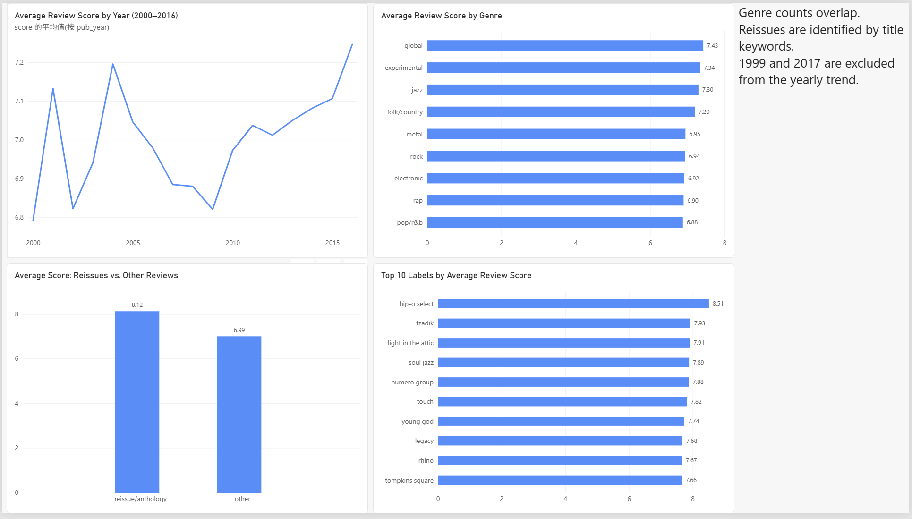

# Pitchfork Reviews: SQL Analysis

SQL analysis of 18,389 Pitchfork album reviews (1999–2017) stored in a relational SQLite database
(reviews, genres, labels, years, artists, content).

Data: https://www.kaggle.com/datasets/nolanbconaway/pitchfork-data
SQL techniques: JOIN, GROUP BY, HAVING, CTE, window functions (RANK), CASE WHEN, subqueries.
Run: open `database.sqlite` (from Kaggle) in SQLite or DB Browser and execute `analysis.sql`.

## Visualization

A Power BI report visualizes yearly score trends, reissue ratings, genre differences,
and the top 10 labels by average review score using CSV exports from the SQL analysis.

[Download the Power BI report](pitchfork_dashboard.pbix)

Genre counts overlap. Reissues are identified by title keywords. The yearly trend
excludes the partial years 1999 and 2017.

## Key findings

1. **Reissues score much higher.** Reviews of reissues, anniversary editions and anthologies
   (180 reviews, identified by title keywords) average 8.12, versus 6.99 for all other reviews.
   The top labels by average score are mostly archival labels: Hip-O Select (8.51), Tzadik (7.93),
   Light in the Attic (7.91), Soul Jazz (7.89), Numero Group (7.88).
2. **Scores have risen since 2009.** Review volume was stable at about 1,100–1,265 per year from
   2004 to 2016, while the average score rose from 6.82 (2009) to 7.25 (2016).
3. **Genre differences are small but clear.** Global (7.43), experimental (7.34) and jazz (7.30)
   score highest; rock, the largest genre with 9,438 reviews, averages 6.94 and pop/r&b is lowest
   at 6.88. Experimental has the highest Best New Music rate (6.7%) and metal the lowest (3.0%).
4. **Reviewers differ a lot.** Among 85 authors with at least 50 reviews, averages range from 7.72
   (Seth Colter Walls) to 6.15 (Adam Moerder), about 1.6 points apart around a site average of 7.0.
   This may partly reflect which albums each author was assigned.

## Data quality notes

- `reviews` has 18,393 rows but 18,389 distinct review IDs (4 duplicates).
- A review can have several genres or labels, so genre counts overlap and should not be summed.
  About 2,300 rows in `genres` have an empty genre.
- Some labels are blank and some authors appear under two names (e.g. "grayson currin" and
  "grayson haver currin"); these were not merged.
- 1999 and 2017 are partial years and were excluded from the yearly trend.
- Reissues were identified by title keywords only, so the count is likely an underestimate.
- Comparing an artist's consecutive albums was not attempted: review date is not release order
  and reissue reviews distort the comparison.
